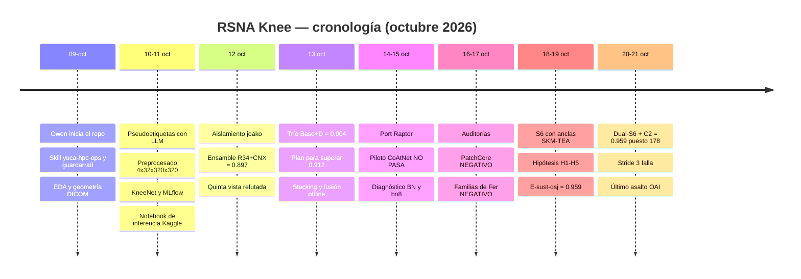
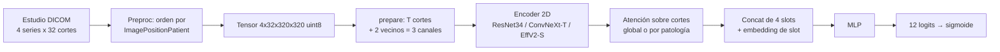
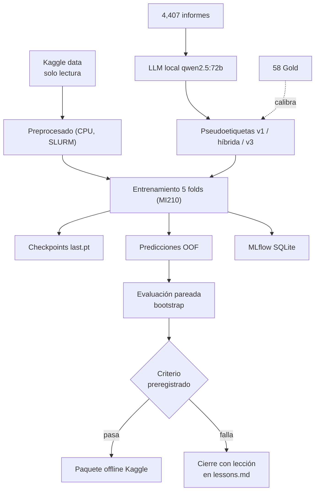
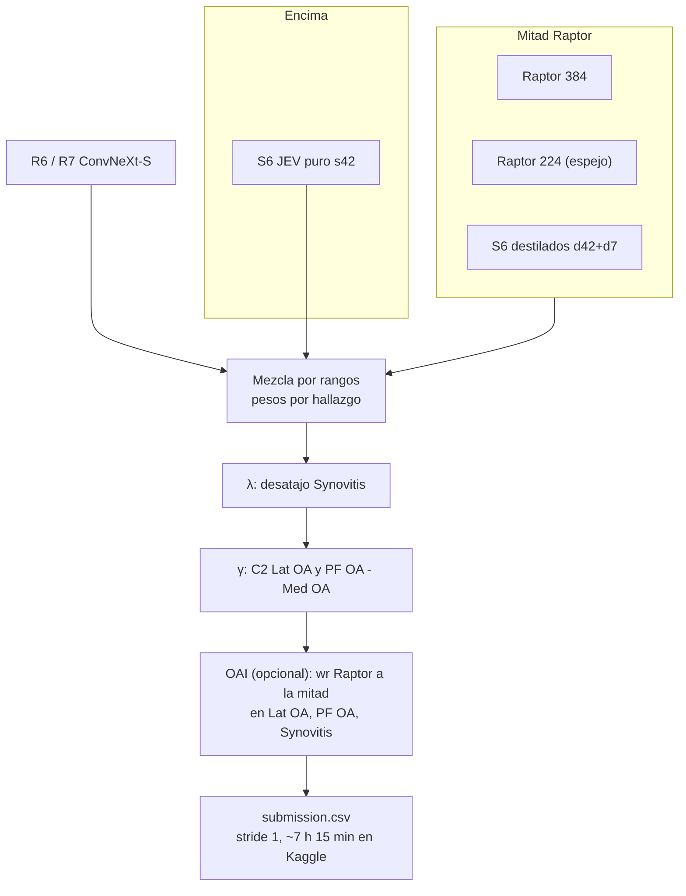
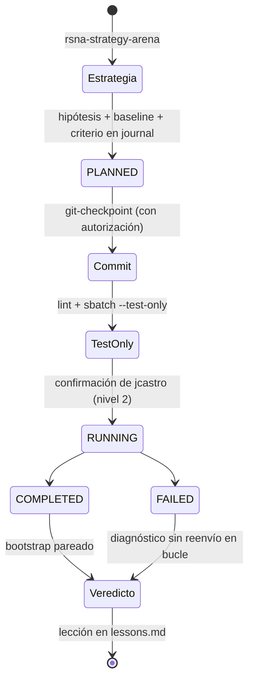
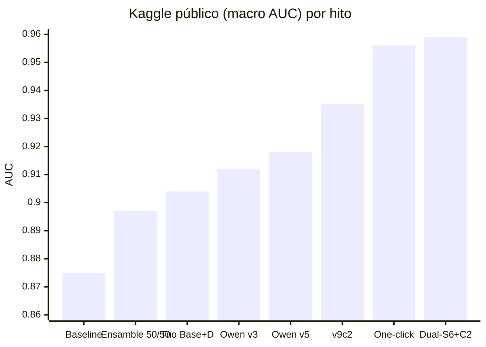

# RSNA Knee Abnormality Detection — Documentación Integral (rama `joako`)

> **Alcance:** reconstrucción de la documentación del proyecto a partir de: reglas de agentes y de uso de Yuca (`.agents/skills/`), `experiments/journal.md` y `lessons.md`, `docs/*.md`, las auditorías de `runs_joako/` y el historial Git (56 commits, 6 sin publicar).
> **Estado de la información:** corte al **2026-10-21 ~15:00 MST**. Cierre de envíos de la competencia: **2026-10-22 23:59 UTC**.
> **Convención de evidencia:** `[V]` verificado en archivos/SLURM, `[R]` reportado en un documento sin re-verificar, `[E]` estimación o inferencia.

## Índice

1. [Contexto y Visión del Proyecto](#1-contexto-y-visión-del-proyecto)
2. [Glosario de Términos](#2-glosario-de-términos)
3. [Evolución y Reconstrucción Histórica](#3-evolución-y-reconstrucción-histórica)
4. [Guía de Reproducibilidad (Setup y Despliegue)](#4-guía-de-reproducibilidad-setup-y-despliegue)
5. [Documentación Técnica y Ejemplos](#5-documentación-técnica-y-ejemplos)
6. [Apoyo Visual y Diagramas](#6-apoyo-visual-y-diagramas)
7. [Anexos: reglas operativas y salvedades](#7-anexos-reglas-operativas-y-salvedades)

---

## 1. Contexto y Visión del Proyecto

### 1.1 Origen

El repositorio participa en la competencia de Kaggle **RSNA Knee Abnormalities Detection**. Se trabaja en el clúster HPC **Yuca** (ACARUS, Universidad de Sonora), proyecto SLURM `p082` (responsable: Victor Manuel Minjares Neriz). El proyecto tiene dos fases y dos autores principales:

| Fase | Autor | Aporte |
|---|---|---|
| Base | **Owen** (rama `owen`, 29 commits del 9 al 12-oct) | EDA y control geométrico de 24,371 series / 819,078 cortes DICOM; pseudoetiquetas desde 4,407 informes con LLM local (`qwen2.5:72b`); arquitectura `KneeNet`; modelos ResNet-34 y ConvNeXt-Tiny; baseline **0.875**. Su línea posterior llegó a 0.912–0.918 con 5 folds × 3–4 familias. |
| Integración y ensambles | **Joako / jcastro** (rama `joako`, 27 commits del 12 al 20-oct) | Aislamiento de infraestructura (`runs_joako`, MLflow propio), evaluador pareado con bootstrap, paquetes de inferencia offline, ensambles propios (0.897 → 0.904) y, después, integración con modelos públicos hasta **0.959**. |

### 1.2 Problema

Predecir la probabilidad de **12 hallazgos** musculoesqueléticos por estudio de resonancia magnética de rodilla (planos sagital, coronal y axial). Métrica: **macro ROC-AUC sobre los 12 hallazgos**.

Dificultades centrales:

- **Etiquetas escasas y ruidosas.** Solo **58 estudios (Gold)** tienen etiquetas oficiales completas; los otros 4,349 tienen pseudoetiquetas derivadas de informes en texto libre, con celdas `NaN` (no mencionado) y ≈20 % de celdas erróneas `[R]`.
- **Gold no es independiente.** Los 58 calibraron el mapeo bayesiano de las pseudoetiquetas, por lo que no sirve para seleccionar modelos sin sesgo.
- **Restricciones operativas.** Clúster compartido (sin papelera en Lustre), cuota de 700 GB, red filtrada por Fortinet, y notebooks de Kaggle sin internet y con límite de tiempo.

### 1.3 Objetivos

1. Reproducir y superar el baseline de Owen mediante ensambles con diversidad arquitectónica.
2. Aplicar rigor experimental: hipótesis y criterio registrados **antes** de ejecutar (Iron Law), bootstrap pareado, decisión sobre `val_int`/OOF y no sobre Gold.
3. Operar el clúster sin dañar datos ni recursos compartidos (guardarraíles técnicos).
4. Maximizar el puesto en el leaderboard público antes del cierre (22-oct).

### 1.4 Alcance

| Dentro | Fuera |
|---|---|
| Entrenamiento, evaluación y ensamble en Yuca; empaquetado offline para Kaggle; registro de experimentos en MLflow local; documentación y auditorías | Envíos a Kaggle (los realiza solo jcastro, a mano); escritura en `kaggle_data/`, `code/`, `runs/`, `preproc/` (de Owen); tareas de administración del clúster |

### 1.5 Resultados principales (Kaggle público)

| Solución | Composición | Score | Fuente |
|---|---|:---:|---|
| Baseline Owen | ResNet-34 (ep 7) | 0.875 | journal |
| Ensamble Base | R34 50 % + ConvNeXt-T 50 % | 0.897 | journal |
| Trío Base+D v2 | R34 25 % + R34-D (slice attention) 25 % + ConvNeXt-T 50 % | 0.904 | `docs/trio_base_d.md` |
| Owen v3 / v5 | 15 / 20 modelos (5 folds × familias) | 0.912 / 0.918 `[R]` | auditorías |
| v9b / v9c2 (Owen, propios) | paquetes OOF | 0.935 `[R]` | resumen sesión 17-19 |
| One-click R7 + Raptor (público) | Raptor 384 + R7 ConvNeXt-S, 50/50 | 0.956–0.957 | `[R]`, sin recibo local |
| **E-sust-dsj / Dual-S6 / Dual-S6 + C2** | mezcla pública + S6 + correcciones | **0.959** (puesto ~210 → 197 → **178**) | journal |
| Dosis 0.2/0.2 (stride 1) | λ=0.2, γ=0.2 | en curso (≈13:45 del 21-oct) | journal |

> [!IMPORTANT]
> A partir del 14-oct, el avance en el leaderboard proviene de **modelos públicos fuertes** (Raptor, S6, R7/R6) mezclados con correcciones estructurales propias, no de las CNN entrenadas en Yuca (≈0.02–0.05 AUC por debajo). Esto está documentado como lección explícita.

---

## 2. Glosario de Términos

### 2.1 Datos y evaluación

| Término | Definición |
|---|---|
| **12 hallazgos** | ACL, MCL, Medial Meniscus, Lateral Meniscus, Medial OA, Lateral OA, PF OA, Effusion, Synovitis, Baker's, Contusion, Fracture (orden fijo de `LABELS` en `rsna/modelo.py`). |
| **Macro AUC** | Promedio simple del ROC-AUC de los 12 hallazgos. |
| **Gold / Gold-58** | 58 estudios con etiquetas oficiales completas. Solo descriptivo; su AUC se infla si se usa para elegir épocas o pesos. |
| **`val_int`** | Validación interna: 415 estudios con `md5(uid) % 10 == 0` (caen en la partición 0 de Owen). Conjunto de decisión. |
| **`val_oficial`** | Los 58 Gold usados como validación; con fuga, solo referencia. |
| **OOF** | *Out-of-fold*: predicción de cada estudio hecha por un modelo que no lo vio. Partición determinista `md5 % 5` sobre 4,349 estudios. |
| **Pseudoetiquetas** | Etiquetas derivadas de informes por LLM. Variantes: v1, híbrida v2, v3 destilada, blendjev, JEV, Omer. |
| **`w = 0` / máscara** | Peso nulo para celdas no mencionadas (`NaN`). **Nunca** se imputan como negativas. |
| **Juez (J1/J2)** | Tabla de etiquetas con que se evalúa; se usan dos de sesgo opuesto para no premiar la tabla de entrenamiento. |
| **Bootstrap pareado** | Remuestreo por estudio con los mismos índices para dos modelos (≥500 réplicas; en trabajos recientes 1,000–2,000). Se reporta Δ, IC 95 % y P(Δ>0). |
| **Preregistro** | Entrada del journal con hipótesis, baseline y criterio de aceptación escritos antes del job. |

### 2.2 Modelos y técnicas

| Término | Definición |
|---|---|
| **2.5D** | Cada corte se apila con sus dos vecinos como 3 canales y entra a una CNN 2D. |
| **Slot / ranura** | Una de 4 series: Sagital FS, Sagital no-FS, Coronal FS, Axial FS. Tensor `(4, 32, 320, 320)` `uint8`. |
| **`KneeNet`** | Red base: encoder 2D + atención sobre cortes + concatenación de 4 slots + MLP a 12 salidas. |
| **`KneeNetAtt` / `slice_patho` / modelo D** | Variante con atención MIL por patología sobre cortes (resuelve lesiones focales de 1–3 cortes). |
| **MIL** | *Multiple-Instance Learning*: el estudio es una "bolsa" de cortes con una sola etiqueta. |
| **Trío Base+D** | Ensamble 0.25 R34 / 0.25 R34-D / 0.50 ConvNeXt-T. |
| **ABCD** | Ensamble de 4 modelos al 25 % (R34 y ConvNeXt, con etiquetas base e híbridas): `val_int` 0.8653. |
| **`effhib` / `cnxhib` / `r34att`** | EfficientNetV2-S / ConvNeXt-T / R34-atención entrenados con supervisión híbrida. |
| **v3 / v4 / v5 (Owen)** | Paquetes de 15 / (v3+effhib) / 20 modelos. |
| **Raptor** | CoAtNet `coatnet_rmlp_2_rw_384` público (checkpoints 384 y 224). |
| **R6 / R7** | Notebooks/modelos públicos (R7: ConvNeXt-S, 4 folds, crop 352, pre-entrenamiento fastMRI). |
| **S6** | ConvNeXt-small de nartaa (0.950 solo, sin OAI), reentrenado aquí. **S6d**: destilado (0.5 JEV + 0.5 Raptor). |
| **Dual-S6** | S6d dentro de la mitad Raptor + S6 JEV puro encima. |
| **Desatajo** | Corrección que resta una fracción de un hallazgo correlacionado espuriamente: **λ** (Synovitis vs. metadatos del centro DICOM) y **γ** (**C2**: Lat OA y PF OA −= γ·rango(Med OA)). |
| **OAI / FOV** | OAI: definición de etiquetas MOAKS/KL del Osteoarthritis Initiative (difiere de la de los expertos). FOV: campo de visión. `OAI-FOV` dio 0.958 (descartada). |
| **Stride** | Paso de ventanas en inferencia de S6 (1 = completo, 3 = más rápido). **Stride 3 falló 2/2 en Kaggle.** |
| **PatchCore / Anomalib** | Detección de anomalías por kNN de parches congelados; cerrada como negativa. |
| **SWA** | Promedio de pesos de las mejores épocas. |
| **TTA** | *Test-time augmentation*. Prohibido el flip horizontal ingenuo (invierte medial/lateral). |

### 2.3 Infraestructura y proceso

| Término | Definición |
|---|---|
| **Yuca / `login-01`** | Clúster HPC y su nodo de acceso compartido (no apto para cómputo pesado). |
| **MI210 / ROCm** | GPU AMD Instinct (`gfx90a`, 64 GB) y su stack (no CUDA). |
| **`QOSGrpGRES`** | Estado de espera SLURM por tope de GPUs de `p082` (≈4). No reenviar ni cancelar. |
| **Lustre** | Sistema de archivos paralelo; sin papelera; lento con muchos archivos pequeños. |
| **MLflow local** | Seguimiento sobre SQLite (`/lustre/proyectos/p082/mlflow/mlflow_joako.db`). |
| **Skill** | Paquete de instrucciones para el agente (`.agents/skills/<tema>/<skill>/SKILL.md`). |
| **Hook / guardarraíl** | `guard_hook.py` revisa cada comando y responde `deny` o `ask`. |
| **Iron Law** | Ningún experimento sin hipótesis y baseline previos en el journal. |
| **Niveles 0–3** | Clasificación de riesgo de acciones (libre / protocolo / confirmación / prohibido). |
| **Gold-58 vs. Kaggle** | Conversión empírica ≈ ×0.5 (un solo punto de calibración) `[E]`. |

---

## 3. Evolución y Reconstrucción Histórica

### 3.1 Línea de tiempo



### 3.2 Historial de commits (resumen por hito)

| Fecha | Commit(s) | Hito |
|---|---|---|
| 09-oct | `e9d1b02` … `4ee551b` | `init`, skill `yuca-hpc-ops`, guardarraíl, scripts de exploración, verificación de geometría. |
| 09–11-oct | `39b5b78` … `ec14a5f` | Piloto de etiquetas desde informes (Ollama), extracción reanudable y consolidación. |
| 11-oct | `ba8defe` … `5dfc85a` | Preprocesamiento a tensores fijos, modelo 2.5D, MLflow/SQLite, inferencia a `submission.csv`, notebook Kaggle, registro de envíos. |
| 12-oct | `9878b91` (Owen), `5bc5273`, `4ffdbbe` | Evaluación de conjuntos; **aislamiento personal** (rutas, SLURM, MLflow) y **ensamble 0.897**. |
| 13-oct | `87e2cd9`, `4b0b2d4`, `8b21ebb` | Documento Trío Base+D (0.904), plan contra 0.912, evaluación de fusión offline y piloto effhib. |
| 14-oct | `5d0ffb7`, `abf274c`, `bccbade`, `4c63cd5`, `f05db2e`, `ffa42d8` | Brazos v5 y DINOv2 para el notebook 0.957, auditoría del silencio en etiquetas, piloto CoAtNet, port de Raptor validado bit a bit, atribución de terceros. |
| 15-oct | `b454400`, `dc11670` | Diagnóstico CoAtNet; atribución de `r7_sources` y ports de dreaddevelopment. |
| 18-oct | `55ee9b5` | Jobs de anclas SKM-TEA y semillas S6. |
| 19-oct | `adef943`, `b9bcfd0`, `3677c6f`, `40d5231` | Investigación `score_0958`, caché de S6 con paridad `px_sha1`, evaluación H1–H5 sobre Gold-58, `.gitignore` ampliado. |
| 20-oct | `2337eb5`, `8c66feb`, `fa2e7fa`, `77cedfc`, `b6442f3`, `cd711d4` | Evaluación Gold de 5 S6 y receta Dual-S6; ViT-L OrthoFoundation; fixes de `anatomy.pt` y `default.yaml`; destilados y etiquetas de Omer. |

> [!WARNING]
> `joako` está **6 commits por delante** de `origin/joako` (`2337eb5` → `cd711d4`). El push de `2337eb5` falló por credenciales. Además hay cambios sin versionar: hook y `settings.json` de `.claude/`, symlinks de skills (la skill `yuca-hpc-ops` se movió a `.agents/`), `journal.md`, `lessons.md`, `rsna/evaluar_fusion_offline.py` y dos jobs. Los commits ahora solo se hacen con autorización explícita (`git-checkpoint`).

### 3.3 Decisiones clave de arquitectura y diseño

| # | Decisión | Motivo / evidencia |
|---|---|---|
| D1 | Tensor fijo `(4,32,320,320) uint8`, cortes ordenados por `ImagePositionPatient` | `InstanceNumber` y nombres de archivo no son fiables entre escáneres. |
| D2 | **No** hacer flips horizontales | Invierten medial/lateral; destruyen la semántica meniscal. |
| D3 | Enmascarar `NaN` (`w=0`), no imputar 0 | El silencio del informe no equivale a negativo (en Gold: Baker's 3 % vs 38 %). |
| D4 | Decidir con `val_int`/OOF; Gold solo descriptivo | Fuga de calibración en `val_oficial`. |
| D5 | Aislamiento por job: `runs_joako/<JOB_ID>/` | Nunca se pisan resultados; reversibilidad. |
| D6 | MLflow local en SQLite | Sin SaaS (Fortinet con inspección SSL). |
| D7 | Ensamble asimétrico 25/25/50 | Mantener 50 % ConvNeXt protege Fracture (0.8426 vs 0.8071 con pesos uniformes). |
| D8 | Atención MIL por patología sobre cortes | Lesiones focales de 1–3 cortes se diluyen con promedio. |
| D9 | Pasar de "más pesos" a "correcciones estructurales fijadas por mecanismo" | Ajustar pesos con 58 estudios sobreajusta; el stacking 12×12 fue refutado. |
| D10 | Separar roles de S6 (Dual-S6) | Destilados dentro de la mitad Raptor; JEV puro encima. Mismo S6 en ambos sitios empeora (0.9392). |
| D11 | Notebooks "estrictos" que fallan con `C_FALLO` si falta un componente | Evita enviar silenciosamente una mezcla degradada. |
| D12 | No usar stride 3 | 2 de 2 envíos terminaron en `Notebook Threw Exception`. |
| D13 | Preregistrar criterios y controles de plomería | Evita leer un cero como hallazgo. |

### 3.4 Resumen de experimentos (journal)

| Experimento | Resultado | Veredicto |
|---|---|---|
| ResNet34 base (job 2080214) | `val_int` 0.8435; Kaggle 0.875 | Base |
| ConvNeXt-T base (2080215) | `val_int` 0.8518 | +0.0083 |
| Ensamble 50/50 (2081432) | 0.8574; Δ vs R34 +0.0139 [0.0074, 0.0201]; Kaggle 0.897 | Éxito |
| Quinta vista `cor_nofs` | Δ +0.0021, IC [−0.0071, +0.0108]; Fracture −0.0268 | Refutada |
| Híbridas (R34 / CNX) | 0.8474 / 0.8582 | Mejora |
| ABCD | 0.8653; Δ +0.0079 [0.0032, 0.0124] | Éxito (no enviado) |
| Trío Base+D v2 | Kaggle 0.904 | Éxito |
| effhib fold 0 propio (2084782) | Duplicaba el de Owen (2084674); cancelado a 18 min | Lección: revisar `runs/` antes de encolar |
| Stacking 12×12 (2084840) | `lr_todas` Δ −0.0016 | Refutado |
| Comparación v3/v4/v5 (2084846) | v4 vs v3 +0.0030; v5 vs v4 +0.0003 (inconcluso) | Informativo |
| Piloto CoAtNet (2085360) | OOF 0.8409 vs effhib 0.8628; Δ −0.0219 | No pasa |
| Diagnóstico CoAtNet (2089449–53) | `bn8`: +0.0199 Gold, +0.0212 OOF; criterio +0.020 | "Casi", sin significancia |
| PatchCore / Anomalib (2089938–2090010) | AUC 0.48–0.56; Δ −0.0037 [−0.0056, −0.0018] | Negativo, cerrado |
| Familias de Fer sobre v9 (2090014) | Mejor Δ +0.0004 | 0/7 adoptables |
| Dual-S6 + dsj | Gold 0.9415; Kaggle 0.959, puesto 197 | Éxito |
| C2 | Gold 0.9421; puesto 178 | Éxito |
| ViT-L OrthoFoundation | Diverso (Spearman 0.77) pero ~7 h en Kaggle | No cabe |
| 4 destilados (2107744) | Δ −0.00015 (P 0.39) | No entra |
| S6 con etiquetas de Omer (2108323) | Δ −0.0014 a 0.0000 | No entra |
| Pares en escala latente (P-LS, P-LP, P-MM), SML | Δ ≤ +0.0006, P < 0.90 | Cerrados |
| Dosis λ/γ 0.3 por regla latente | Gold 0.9447 | Lista; condicionada al público de 0.2 |
| OAI sola | Gold +0.0047, P 0.997 | Pasa en Gold; decide el público |
| FOV sola (plan B) | Gold +0.0011, P 0.92 | Respaldo |

### 3.5 Lecciones transversales

1. **Verificar antes de entrenar:** revisar `runs/` de Owen evita duplicar GPU.
2. **Decidir con OOF o `val_int`:** Gold con n=58 tiene ±0.02–0.03 de ruido entre épocas.
3. **Una variable por vez**; "casi pasa" no es éxito ni fracaso.
4. **Medir tiempo por etapa** antes de diseñar una mezcla para Kaggle (ViT-L, stride).
5. **Un componente nuevo necesita un envío completo** antes de construir encima; no apilar dos envíos sobre una configuración no probada.
6. **Puntajes de anomalía** con correlación >0.9 entre hallazgos miden "rareza genérica".
7. **Pseudoetiquetas más precisas** en un subconjunto seguro no dieron más AUC.

---

## 4. Guía de Reproducibilidad (Setup y Despliegue)

### 4.1 Requisitos

| Elemento | Especificación |
|---|---|
| Acceso | Cuenta Yuca con membresía en el proyecto `p082` (login: `login-01`, `yuca.unison.mx`) |
| Hardware | GPU AMD Instinct MI210 (`gfx90a`, 64 GB); CPU AMD EPYC |
| Software | Python ≥ 3.10 (`/apps/miniconda3/bin/python`), PyTorch **2.8.0+rocm6.4**, torchvision 0.23.0+rocm6.4 |
| Librerías | `numpy pandas pyarrow scipy scikit-learn pillow opencv-python-headless matplotlib tqdm timm pydicom pylibjpeg*` y `mlflow-skinny==3.8.1`, `sqlalchemy==2.0.45`, `alembic==1.17.2` |
| Datos | `/lustre/proyectos/p082/kaggle_data/competitions/rsna-knee-abnormality-detection/` (solo lectura, ~570 GB, ~820k archivos) |
| Cuota | 700 GB de grupo (uso al 15-oct: ~549–558 GB) |

> [!NOTE]
> El stack del sistema es ROCm 7.2.x, pero el `requirements.txt` usa el build ROCm 6.4 de PyTorch (documentado por los administradores). Verifica la versión del nodo (`rocminfo`, `rocm-smi`) dentro de un job antes de reinstalar.

### 4.2 Paso 1 — Clonar y posicionarse

```bash
cd /lustre/proyectos/p082
git clone <URL_DEL_REPO> code_joako        # requiere red: es acción nivel 2
cd code_joako && git switch joako
git status -sb                             # solo lectura: verifica el estado
```

### 4.3 Paso 2 — Entorno virtual (desde el login node; los nodos de cómputo no tienen salida fiable a internet)

```bash
/apps/miniconda3/bin/python -m venv /lustre/proyectos/p082/venvs/rsna
/lustre/proyectos/p082/venvs/rsna/bin/pip install --no-cache-dir -r requirements.txt
```

Instalación de referencia con versiones exactas: `requirements.lock.txt`. Comprobar con `sbatch jobs/prueba_entorno.slurm`.

> [!CAUTION]
> Nunca desactives la verificación TLS (`pip --trusted-host`, `curl -k`). Si falla por Fortinet (`CERTIFICATE_VERIFY_FAILED`), descarga fuera del clúster y sube con `scp`.

### 4.4 Paso 3 — Preprocesamiento (job de CPU)

```bash
sbatch jobs/preprocesar.slurm        # → /lustre/proyectos/p082/preproc_joako/ (tensores 4x32x320x320 uint8)
# Variantes: preprocesar_v2.slurm, preprocesar_v3_smoke.slurm; Raptor: rsna/raptor_preproc.py
```

### 4.5 Paso 4 — Etiquetas

Las pseudoetiquetas se generan desde informes con Ollama (`jobs/extraer_etiquetas.slurm`, `jobs/consolidar_etiquetas.slurm`), con los modelos en `ollama-models/` (compartidos, **no escribir**). Tablas usadas:

- `preproc/etiquetas_v1_2079203.parquet` (v1, calibrada con los 58 Gold)
- `runs_cons/datos/etiquetas_candidatas_v2_hibridas.parquet` (híbrida v2)

### 4.6 Paso 5 — Entrenamiento (job de GPU, nivel 2: requiere confirmación)

Plantilla basada en `.agents/skills/operacion/yuca-hpc-ops/assets/job_template.slurm`:

```bash
#!/bin/bash
#SBATCH -A p082
#SBATCH -J rsna-NOMBRE
#SBATCH -p gpu                       # confirmar con: sinfo -s
#SBATCH --nodes=1 --ntasks=1 --cpus-per-task=8 --mem=32G --time=04:00:00
#SBATCH --gres=gpu:1
#SBATCH -o logs/%x_%j.out
#SBATCH -e logs/%x_%j.err
set -euo pipefail

PROJ=/lustre/proyectos/p082
OUT="$PROJ/runs_joako/${SLURM_JOB_ID:?}"      # directorio NUEVO por job
mkdir -p "$OUT"
cd "$PROJ/code_joako"
echo "commit=$(git rev-parse --short HEAD)" | tee "$OUT/commit.txt"
source "$PROJ/venvs/rsna/bin/activate"

python rsna/entrenar.py \
  --data  "$PROJ/preproc/v1_train" \
  --labels "$PROJ/runs_cons/datos/etiquetas_candidatas_v2_hibridas.parquet" \
  --out   "$OUT" --backbone resnet34 \
  --weights "$PROJ/modelos/torch/resnet34-b627a593.pth" \
  --epochs 8 --batch 8 --slices 16 --crop 288 --folds 10 --fold 0 \
  --mlflow sqlite:////lustre/proyectos/p082/mlflow/mlflow_joako.db \
  --mlflow-artifacts /lustre/proyectos/p082/mlflow/artifacts_joako
```

Protocolo de envío (de `yuca-hpc-ops`):

1. Registrar hipótesis y baseline en `experiments/journal.md` (**antes** del job).
2. Escribir el script en `jobs/` y validarlo: `python .claude/hooks/check_slurm.py jobs/<script>.slurm`.
3. Commit (con autorización) — el job debe correr el código versionado.
4. `sbatch --test-only jobs/<script>.slurm`.
5. Resumir recursos, entradas, salidas y espacio estimado a jcastro y esperar autorización.
6. `sbatch` y anotar el JOBID. Monitorear con `squeue`/`sacct` como máximo cada 60 s.

### 4.7 Paso 6 — Evaluación pareada de ensamble

```bash
python rsna/evaluar_ensamble.py \
  --data  /lustre/proyectos/p082/preproc/v1_train \
  --labels path/to/labels.parquet \
  --ckpt-resnet  path/to/resnet34/best_oficial.pt \
  --ckpt-convnext path/to/convnext/best_oficial.pt \
  --out ./resultados_evaluacion --batch 8
# En Yuca: sbatch jobs/evaluar_ensamble.slurm  (los scripts *_cpu.slurm son de CPU)
```

### 4.8 Paso 7 — Inferencia y paquete Kaggle (Trío Base+D)

```bash
python rsna/inferir.py \
  --data /ruta/datos/competencia --split test \
  --checkpoints pesos/resnet34_job2080214_ep7.pt \
                pesos/resnet34_d_job2084614_ep6.pt \
                pesos/convnext_tiny_job2080215_ep5.pt \
  --weights 0.25 0.25 0.50 --out submission.csv --batch 4
```

Estructura del dataset privado de Kaggle: `inferencia.ipynb`, `pesos/*.pt`, `rsna/{inferir,modelo,modelo_att,preproc}.py` y `wheels/` (pydicom, pylibjpeg*) para instalar sin internet. Los SHA-256 de checkpoints están en `docs/trio_base_d.md` §G.

### 4.9 Seguimiento con MLflow

```bash
export MLFLOW_TRACKING_URI="sqlite:////lustre/proyectos/p082/mlflow/mlflow_joako.db"
# Registro de envíos: rsna/registrar_envio.py; historial previo: rsna/registrar_mlflow.py
```

### 4.10 Verificación y problemas frecuentes

| Síntoma | Causa | Acción |
|---|---|---|
| Job `PD (QOSGrpGRES)` | Tope de GPUs de `p082` | Esperar; no reenviar |
| OOM / `amdgpu` inconsistente | OOM en GPU | `--exclude=<nodo>` y avisar a administradores |
| `SIGABRT` en MIOpen | Caché MIOpen compartida corrupta | `MIOPEN_USER_DB_PATH` local |
| Job falla en 0–3 s | Directorio de salida inexistente / assert | Revisar `.err`; no reenviar en bucle |
| `CERTIFICATE_VERIFY_FAILED` | Fortinet | Descargar fuera y `scp` |
| Anomalib OOM en CPU | Smoke necesita ≥32 GB | `--mem=32G` |
| `Notebook Threw Exception` en Kaggle | Stride 3 / componente sin ventanas | Usar stride 1 |

---

## 5. Documentación Técnica y Ejemplos

### 5.1 Estructura del repositorio

```text
code_joako/
├── rsna/                  # Código: modelos, preproc, entrenamiento, evaluación, inferencia, sprints
├── jobs/                  # Scripts SLURM (~75): entrenar_*, evaluar_*, s6_*, *_cpu
├── experiments/           # journal.md (append-only), lessons.md, planes y campañas
├── docs/                  # Informes, auditorías, resúmenes de sesión
├── research/              # Scripts del "último asalto" (oai.py, fov.py, tetra.py, ...)
├── .agents/skills/        # Skills (fuente de verdad); .claude/skills/ solo symlinks
├── .claude/               # hooks (guard_hook.py, check_slurm.py) y settings
├── envios_joako/          # Paquetes offline para Kaggle (v1, v2_trio, candidato_trio_d, ABCD)
├── requirements*.txt      # Entorno
└── (ignorados por git)    # runs_joako/, models/, referencias/, anomalib_offline/, *.parquet, *.csv, *.npz
```

### 5.2 Modelo base — [`rsna/modelo.py`](file:///lustre/home/jcastro/rsna/code_joako/rsna/modelo.py)

```python
# Entrada: x (B, S=4 slots, T cortes, 3 canales vecinos, H, W) y present (B, S)
class KneeNet(nn.Module):
    def __init__(self, backbone="resnet34", weights_path=None, n_slots=4, n_out=12, dropout=0.3):
        super().__init__()
        self.encoder, feat = make_encoder(backbone, weights_path)       # CNN 2D preentrenada
        self.slot_emb = nn.Parameter(torch.zeros(n_slots, feat))        # embedding por serie
        self.attn = nn.Sequential(nn.Linear(feat,128), nn.Tanh(), nn.Linear(128,1))
        self.head = nn.Sequential(nn.Dropout(dropout), nn.Linear(feat*n_slots,512),
                                  nn.GELU(), nn.Dropout(dropout), nn.Linear(512,n_out))

    def forward(self, x, present):
        b, s, t = x.shape[:3]
        f = self.encoder(x.flatten(0, 2).contiguous(memory_format=torch.channels_last))
        f = f.mean(dim=(2, 3)).float().view(b, s, t, -1) + self.slot_emb[None, :, None, :]
        a = self.attn(f).softmax(dim=2)                                  # atención sobre cortes
        z = (a * f).sum(dim=2) * present[..., None].to(f.dtype)          # anula slots ausentes
        return self.head(z.flatten(1))                                   # 12 logits
```

`prepare(x, n_slices, train)` toma `T` cortes equiespaciados (desplazamiento aleatorio al entrenar), añade los dos vecinos como canales, aplica jitter suave de brillo/contraste y normaliza con medias/desviaciones de ImageNet.

### 5.3 Atención por patología — `rsna/modelo_att.py`

`KneeNetAtt` (con `prepare_att` y `masked_softmax`) calcula una distribución de atención **por hallazgo** sobre los cortes, con máscara de cortes válidos (`slice_valid`). Es el "modelo D" del Trío y la familia `r34att` de Owen v5.

### 5.4 Ensamble ponderado y rango

```python
import numpy as np
from scipy.stats import rankdata

def media_ponderada(probs, pesos):
    """probs: lista de arrays (N, 12). Promedio de probabilidades (Trío: 0.25/0.25/0.50)."""
    return sum(w * p for w, p in zip(pesos, probs)) / sum(pesos)

def rango(p):
    """Rango percentil por hallazgo (columna), en [0, 1]."""
    return np.apply_along_axis(lambda c: (rankdata(c) - 1) / (len(c) - 1), 0, p)
```

### 5.5 Desatajo de compartimento (C2) y Synovitis (λ)

Fórmulas fijadas por mecanismo (no ajustadas con AUC). Con `LABELS` en el orden de §2.1:

```python
def aplicar_c2(r, gamma=0.1):
    """C2: resta parte del rango de Medial OA en Lateral OA y PF OA (rangos 0-1)."""
    i = {n: k for k, n in enumerate(LABELS)}
    for h in ("Lateral OA", "PF OA"):
        r[:, i[h]] = rango((r[:, i[h]] - gamma * r[:, i["Medial OA"]])[:, None])[:, 0]
    return r
# Synovitis (dsj): rango(Syn) - λ·(proyección sobre rasgos de metadatos DICOM del centro)
# Implementación real: construir_notebook_dual_s6_dsj.py --dc --lam 0.2 --gam 0.2 [--oai] [--fov]
```

> [!NOTE]
> El fragmento ilustra la lógica descrita en el journal (`Lat OA` y `PF OA` −= γ·rango(`Med OA`)). La implementación autoritativa vive en `runs_joako/exp_Dual_S6_dsj/construir_notebook_dual_s6_dsj.py` (fuera de Git).

### 5.6 Bootstrap pareado (plantilla de evaluación)

```python
import numpy as np
from sklearn.metrics import roc_auc_score

def macro_auc(y, p, w):
    aucs = []
    for c in range(y.shape[1]):
        m = w[:, c] > 0
        if m.sum() and len(np.unique(y[m, c])) == 2:
            aucs.append(roc_auc_score(y[m, c], p[m, c]))
    return float(np.mean(aucs))

def bootstrap_pareado(y, w, pa, pb, B=1000, seed=20261013):
    """Δ = AUC(pb) − AUC(pa) con los MISMOS índices remuestreados (nivel estudio)."""
    rng = np.random.default_rng(seed)
    d = []
    for _ in range(B):
        idx = rng.integers(0, len(y), len(y))
        d.append(macro_auc(y[idx], pb[idx], w[idx]) - macro_auc(y[idx], pa[idx], w[idx]))
    d = np.array(d)
    return d.mean(), np.percentile(d, [2.5, 97.5]), (d > 0).mean()   # Δ, IC95, P(Δ>0)
```

Criterios típicos del proyecto: éxito si IC95 inferior > 0 y P(Δ>0) ≥ 0.95 (OOF), o P ≥ 0.85–0.90 en Gold, con tope de caída por hallazgo (−0.005 a −0.015). Se fijan **antes** de ver el resultado.

### 5.7 Partición determinista

```python
import hashlib
def fold(uid: str, k: int = 5) -> int:
    return int(hashlib.md5(uid.encode()).hexdigest(), 16) % k
# val_int: fold(uid, 10) == 0   |   OOF: fold(uid, 5) en {0..4}   |   Gold: excluidos del entrenamiento
```

### 5.8 Plantilla de entrada del journal

```markdown
### [YYYY-MM-DD HH:MM] — Nombre del experimento
- **Estado**: PLANNED | RUNNING | COMPLETED | FAILED
- **Job SLURM**: <JOB_ID>  |  **Commit Git**: `<hash7>`
- **Hipótesis**: ...      - **Modificación**: (una sola variable)
- **Baseline de Referencia**: métrica exacta a superar
- **Criterio de Aceptación**: fijado antes de lanzar
- **Resultados / Delta / Duración / Lección / Siguiente paso**
```

### 5.9 Skills de agentes (orden de uso y precedencia)

| Skill | Función | Autoridad |
|---|---|---|
| `rsna-strategy-arena` | Elegir qué experimento merece cómputo (rutas divergentes, abogado/fiscal, refutador mínimo, criterios previos); máximo 1–2 recomendaciones + 1 respaldo | Solo lectura |
| `rsna-experiment-lifecycle` | Journal antes del job, trazabilidad, bootstrap pareado, cierre con lección | Ejecuta con autorización |
| `yuca-hpc-ops` | Operación segura en Yuca (niveles de riesgo, SLURM, Lustre) | **Máxima** |
| `git-checkpoint` | Commits atómicos con Conventional Commits (`feat`, `fix`, `docs`, `test`, `refactor`, `chore`), archivos por nombre | Propone; actúa con autorización |

Jerarquía ante conflicto: `yuca-hpc-ops` > `rsna-experiment-lifecycle` > `git-checkpoint` > `rsna-strategy-arena`.

---

## 6. Apoyo Visual y Diagramas

### 6.1 Arquitectura del modelo



### 6.2 Flujo de datos y etiquetas



### 6.3 Ensamble final (Dual-S6 + correcciones, estado 21-oct)



### 6.4 Ciclo de un experimento (Iron Law)



### 6.5 Niveles de riesgo en Yuca

| Nivel | Qué incluye | Autorización |
|:---:|---|---|
| **0** | Lectura de `p082`, `squeue/sacct`, escribir en `code_joako/`, `runs_joako/`, `/tmp/claude-<UID>`, `sbatch` de CPU validado, Python ligero (<1 min) | Libre |
| **1** | `git commit`, crear subdirectorios de salida, preparar scripts SLURM | Con protocolo y reporte |
| **2** | `git push`, `sbatch` con GPU, `rm` en `runs_joako/` o `backups/`, descargas/red, `scancel <id>`, `chmod -R`, copias >1 GB, `salloc`, trabajos >1 GPU/24 h/1 nodo | Confirmación explícita por acción |
| **3** | Escribir en `kaggle_data/`, `rm -r`, `sudo`, `scontrol update`, `scancel` masivo, desactivar TLS, leer secretos, `nohup`/`&`/`crontab` en login, `curl \| sh`, reescribir historia Git, tocar hooks | **Prohibido** |

### 6.6 Evolución del score público



---

## 7. Anexos: reglas operativas y salvedades

### 7.1 Reglas de uso de Yuca (síntesis)

- **Principios:** mínimo alcance, lectura primero, reversibilidad, humano en el circuito, no suponer, no eludir salvaguardas (si un hook bloquea, detenerse y explicar).
- **Rutas:** trabajo en `code_joako` (rama `joako`) y `runs_joako/<JOB_ID>/`; `code/`, `runs/`, `preproc/`, `envios/` (de Owen) y `envs/`, `nllb/` son solo lectura; `kaggle_data/` jamás se escribe ni se recorre con `find/du/ls -R`.
- **Login node:** solo edición, colas y lectura; todo lo que supere 1 minuto o unos GB de RAM va por SLURM. `/scratch` de nodos se purga cada 7 días.
- **Scripts:** proteger variables (`rm -- "${OUT:?}/tmp.bin"`), declarar `-A p082`, tiempo, memoria y logs con `%j`.
- **Git:** nada de datos/checkpoints/logs/credenciales en commits; `git add` por nombre; sin `--force`; `commit` y `push` solo con autorización.
- **Si algo falla:** parar, reportar, no "arreglar" con una acción más fuerte; si un nodo falla, `--exclude`.
- **Cambios al hook o a la skill:** el agente no los edita; prepara un parche en `backups/` y jcastro lo aplica y corre `scripts/test_guard.py`.

### 7.2 Salvedades de fidelidad

1. **Referencia 0.956 no verificada.** `registro_submissions_20261016.md` no encontró recibo, ID ni CSV; se infiere que corresponde al notebook one-click R7 + Raptor `[E]`. Las cifras del leaderboard (6,288 equipos, bloques por score) son del CSV del 21-oct `[R]`.
2. **Conversión Gold → público ≈ ×0.5** surge de un solo punto (C2). No es una calibración robusta.
3. **Hipótesis del fallo en stride 3** (series cortas sin ventanas → `C_FALLO`) no está confirmada; la alternativa es tiempo.
4. **Etiquetas de terceros:** Omer (CC BY-NC 4.0); pesos y notebooks públicos tienen atribución en `THIRD_PARTY_NOTICES.md`. Cumplimiento OAI (regla 2.6.b) figura como **abierto** en el sprint del 17-oct.
5. **Datos de la competencia** (identificadores, etiquetas derivadas, CSV/parquet/npz) no salen del clúster ni entran al repositorio (`.gitignore`).
6. **El documento `journal.md` no se editó** al generar esta documentación; las discrepancias entre documentos (p. ej. "estado PLANNED obsoleto" del diagnóstico CoAtNet detectado en la auditoría del 16-oct) deben resolverse en el journal por separado.
7. **Los fragmentos de §5.4–5.7** son implementaciones ilustrativas coherentes con lo documentado; las versiones autoritativas están en `rsna/` y `runs_joako/` (esta última fuera de Git).

### 7.3 Documentos fuente

| Categoría | Archivos |
|---|---|
| Reglas | `.agents/skills/README.md`, `yuca-hpc-ops/{SKILL.md, references/*}`, `rsna-experiment-lifecycle`, `rsna-strategy-arena`, `git-checkpoint` |
| Experimentos | `experiments/{journal,lessons,plan_patchcore_patologias,comparacion_fer_sobre_v9_2026-10-17,campana_*}.md` |
| Docs | `docs/{trio_base_d, plan_superar_owen_0912, auditoria_*, evaluacion_*, hipotesis_ensemble_2026-10-19, sprint_investigacion_2026-10-17, argon-informe-final, resumen_sesion_*}.md` |
| Auditorías `runs_joako` | `auditoria_estrategica_20261016`, `auditoria_fer_20261016`, `registro_submissions_20261016`, `decision_siguiente_experimento_20261016` |

